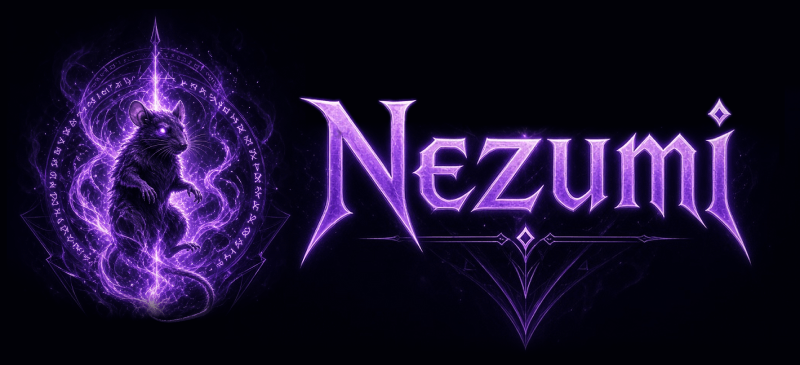

# Nezumi Engine

    

## Overview

**Nezumi** is a 2D (3D planned) game engine built using C++20 designed for personal hobby game projects. It currently features:

- **Event System**: Time-based publish-subscribe event bus  
- **Render Hardware Interface (RHI)**: Device abstraction layer (Backends: OpenGL; Vulkan and DX12 planned) 
- **Renderer**: For loading graphics assets, setting up camera views, and automatically batch drawing render objects (sprites, shapes, etc.)
- **Controllers**: Input-driven gameplay helpers, e.g. an RTS-style camera controller (key/edge/drag pan, zoom to cursor)
- **Platform**: SDL3 for windowing, input, and application-level events
- **Entity System**: Supports simulation of ~20k active units at 60 FPS
- **World System**: Chunk-based sparse set of "Realms" (similar to Factorio surfaces)

Planned features and improvements include:

- **Audio System**: Sound effects and music
- **Entity Component System (ECS)**: Archetype and chunk based data-oriented entity framework
- **Physics**: AABB collision system
- **Serialization**: Saving and loading game data
- **Networking**: Determinitic lockstep for low-bandwidth multiplayer games
- **GUI Manager**: Menus and other UI elements

## Documentation

Please see [docs/getting-started.md](docs/getting-started.md) for instructions on how to use the Nezumi Engine.

## Examples

- [Scrapfall](https://elchupathingy.itch.io/scrapfall)
- Nightmourn (planned)

## License
 
Nezumi is free and open source under the [MIT License](LICENSE.txt).
